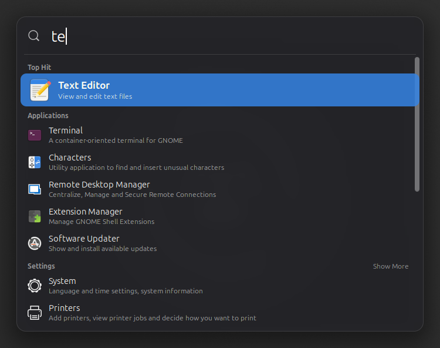
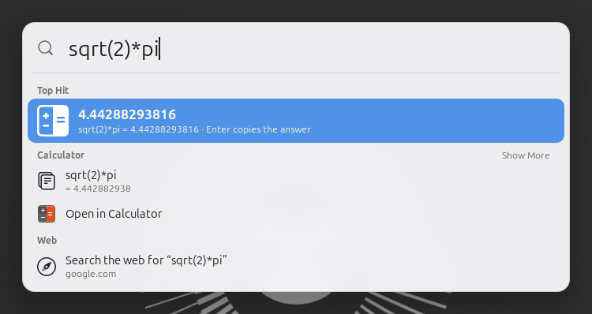

<div align="center">

# 🔦 HighBeam

**Spotlight for GNOME. Hit a key, type a few letters, you're there.**





</div>

Press **Ctrl+Super+Space** anywhere and a search box drops in over whatever
you're doing. No Activities Overview, no workspace zoom, no losing your place.
Apps, open windows, files, settings, characters, sums: one box, one keystroke
to open the right thing.

## ✨ Highlights

- ⚡ **Instant.** App results appear as you type; slower sources (Files,
  Software…) stream in as they answer and never hold up the rest.
- 🎯 **One Top Hit.** The best match across everything goes first, so Enter
  usually does what you meant.
- 🧠 **Learns your habits.** Pick Terminal after typing "te" a couple of times
  and it becomes the Top Hit for "te". Fades over a few weeks; stays on your
  machine.
- 🧮 **Built-in calculator.** `2^10`, `sqrt(2)*pi`, `12 × 4`, `5!`. The answer
  is the Top Hit and Enter copies it.
- 🪟 **Jump to any window** on any workspace by its title or app.
- 🔌 **Every GNOME search provider** (Files, Settings, Characters, Clocks,
  Software…), following your choices in Settings → Search.
- 🌐 **Web search fallback** when nothing local matches, with any search
  engine you like.
- 🎨 **Make it yours.** Light, dark or follow the system; blur, opacity, size,
  text size, section order. Every change applies live.
- ♿ **Screen-reader friendly.** The selected result is announced as you type
  and move.

## 🚀 Install

From a release zip, or one you build with `make pack`:

```sh
gnome-extensions install --force highbeam@sennlab.com.shell-extension.zip
```

Log out and back in (Wayland needs this), then switch HighBeam on in the
**Extensions** app.

> [!TIP]
> GNOME already uses `Super+Space` for switching keyboard layouts, which is
> why HighBeam defaults to `Ctrl+Super+Space`. Pick any shortcut you like in
> HighBeam's settings; it warns you if GNOME already uses it.

## ⌨️ Keys

| Key | Does |
|---|---|
| <kbd>Ctrl</kbd>+<kbd>Super</kbd>+<kbd>Space</kbd> | Open / close (changeable) |
| <kbd>↑</kbd> <kbd>↓</kbd> · <kbd>Tab</kbd> · <kbd>Page Up</kbd> <kbd>Page Down</kbd> | Move through the results |
| <kbd>Enter</kbd> | Open the selected result (copy a calculator answer) |
| <kbd>Ctrl</kbd>/<kbd>Alt</kbd>+<kbd>Enter</kbd> | New window for apps; "show all in the app" for other results |
| <kbd>Ctrl</kbd>+<kbd>1</kbd> … <kbd>9</kbd> | Open the Nth result |
| <kbd>Esc</kbd> | Clear the query; again to close |

Clicking outside the popup closes it, and clicking a result opens it.

## 🔎 What you can search

| Section | What it finds | Enter does |
|---|---|---|
| **Calculator** | `+ - * / % ^ !`, brackets, `2pi`, `pi e tau`, `sqrt cbrt abs sin cos tan asin acos atan ln log log2 exp floor ceil round` (radians) | Copies the answer |
| **Applications** | Installed apps by name, keywords and category ("browser" → Firefox), plus Lock Screen, Log Out, Power Off… | Launches or focuses it |
| **Windows** | Open windows on every workspace, by title or app | Switches to the window |
| **GNOME providers** | Files, Settings panels, Characters, Clocks, Software and whatever else is enabled in Settings → Search | Opens it in that app |
| **Web** | "Search the web for …" | Opens your browser |

The calculator leaves things that only look like sums alone: IP addresses,
version numbers and phone numbers aren't multiplied together. Power Off,
Restart and Log Out still ask first, just like in the Overview.

## 🎛️ Settings

Open the **Extensions** app → HighBeam → ⚙, or run
`gnome-extensions prefs highbeam@sennlab.com`.

| Page | What's there |
|---|---|
| **General** | Shortcut · open on the pointer's or the primary monitor · remember the last query · results per section |
| **Appearance** | Theme (system, dark, light) · background opacity · blur and its radius · corner radius · width · list height · text size · one-click reset |
| **Search** | Switch the calculator, windows, system actions, web search and learning on or off · web search URL (`%s` = the query) · forget what HighBeam learned · reorder the sections |

The popup always fits the screen it opens on, whatever the size settings say.

## 🔒 Privacy

Everything happens on your machine. The only thing HighBeam stores is which
results you picked, in `~/.local/share/highbeam/history.json`, so it can rank
them higher next time. Windows, calculator answers and web searches are never
recorded. Turn learning off or wipe it from the **Search** page. Nothing is
sent anywhere unless you choose the web search result, which opens your
browser.

## ♿ Accessibility

Keyboard focus stays in the search box while you move through the results, so
HighBeam tells screen readers such as Orca which result is selected: its name,
description and position ("Top Hit: Terminal, A container-oriented terminal
for GNOME, 1 of 16"). The list, its headings and its rows have accessible
names and roles, and everything works from the keyboard.

## 🛠️ Development

| Command | What it does |
|---|---|
| `make install` | Compile the schema and symlink this folder into `~/.local/share/gnome-shell/extensions/` |
| `make enable` | Add HighBeam to the enabled extensions (applies at the next shell start) |
| `make nested` | Run GNOME Shell in a window for testing. Prints only HighBeam's log lines; the full log is `build/nested.log` (`VERBOSE=1` prints all, `MODE=1920x1080 SCALE=2` changes the screen) |
| `make logs` | Follow GNOME Shell's log |
| `make test` | Unit tests for the engine, ranking, calculator and history (`gjs -m tests/run.js`) |
| `make lint` | ESLint (fetched with `npx`) |
| `make pack` | Build `build/highbeam@sennlab.com.shell-extension.zip` (with compiled translations, if any) |
| `make pot` | Update the translation template `po/highbeam.pot` (needs `gettext`) |

On Wayland a running session only loads a newly installed extension after you
log out and back in; `make nested` lets you try changes without that.

<details>
<summary><b>How it's built</b></summary>

HighBeam has its own popup and its own search engine. It calls the same
providers the Overview uses, but never touches the Overview itself, so it
doesn't break when GNOME rearranges the Overview's internals.

```
extension.js                        enable()/disable(): creates and destroys the Controller
prefs.js                            preferences window, shortcut capture
src/controller.js                   hotkey, modal grab, placement, show/hide, activation
src/ui/panel.js                     search entry, keyboard handling, appearance
src/ui/resultList.js                Top Hit, sections, rows, selection, announcements
src/search/engine.js                debounce, cancellation, streaming, stale results, Top Hit
src/search/ranking.js               text scoring                         (pure JS, tested)
src/search/calculator.js            arithmetic parser, no eval           (pure JS, tested)
src/search/history.js               learned picks and their boosts       (pure JS, tested)
src/util/historyFile.js             async load/save of the history
src/search/providers/apps.js        installed apps and GNOME system actions
src/search/providers/remote.js      GNOME's D-Bus search providers
src/search/providers/calculator.js  ┐
src/search/providers/windows.js     ├ HighBeam's own results
src/search/providers/web.js         ┘
```

See [PLAN.md](PLAN.md) for the design and roadmap, and
[CHANGELOG.md](CHANGELOG.md) for what changed in each version.

</details>

<details>
<summary><b>Translating</b></summary>

Run `make pot`, copy `po/highbeam.pot` to `po/<language>.po` (for example
`po/de.po`), translate it with a tool such as Poedit, and add the language
code to `po/LINGUAS`. `make pack` compiles every `po/*.po` into the zip.

</details>

<details>
<summary><b>Releasing to extensions.gnome.org</b></summary>

1. Update `version-name` in `metadata.json` and `CHANGELOG.md`.
2. `make lint test pack`.
3. Install the zip and run through the manual checks in
   [PLAN.md](PLAN.md#4-testing-strategy).
4. Upload `build/highbeam@sennlab.com.shell-extension.zip` at
   <https://extensions.gnome.org/upload/>.

What reviewers check, and where HighBeam stands:

- Nothing is created or patched before `enable()`, and `disable()` undoes
  everything: the keybinding, every signal connection, timer and actor goes
  in `Controller.destroy()`.
- No synchronous file or process I/O in GNOME Shell; the history file is read
  and written asynchronously, and only once something has been learned.
- No `eval`: the calculator has its own parser.
- Clipboard use (calculator answers) and the local history are declared in
  the description.
- No compiled schema in the zip; `session-modes` is left at the default, so
  HighBeam never runs on the lock screen.
- Logging is limited to errors and a few warnings about unusable data.

</details>

## 📄 License

GPL-2.0-or-later. See [LICENSE](LICENSE). The approach was informed by
[Search Light](https://github.com/icedman/search-light) by icedman.
